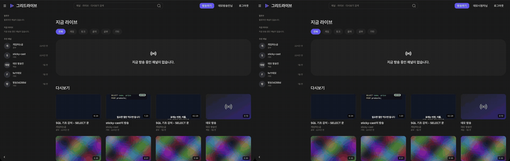

# 그리드라이브 (GridLive)

**설치 없이 브라우저 하나로 방송하고, 시청자가 늘면 시청자끼리 영상을 나눠 받아 서버 부담을 줄이는 실시간 라이브 방송 웹 서비스입니다.**

| 바로가기 | |
|---|---|
| **서비스 주소** | **https://gridlive.duckdns.org** |
| **시연** | [`docs/demo.md`](docs/demo.md) — 흐름별 GIF 10개(F1~F10) · 소리 있는 영상(mp4) 2개 · 테스트 결과 |
| **테스트 계정 · 기능 확인** | [`docs/guide.md`](docs/guide.md) — 방송인 · 시청자 계정(비밀번호 공용), PC · 모바일 송출 → 시청 → 클립 → 종료 순서, 지원 환경 |
| **실행 방법** | [`docs/setup.md`](docs/setup.md) — 실행 환경 · 환경변수 예시 · 운영 배포 · 로컬 개발 |



## 한눈에 보기

| | |
|---|---|
| 송출 | PC 화면 + 탭 · 시스템 소리 + 마이크 믹싱, 휴대폰 카메라 + 마이크, OBS · Larix(스트림 키, WHIP · RTMP) |
| 시청 | WebRTC(WHEP) 저지연 재생, 시청자가 많으면 **그리드 모드**(HLS + 시청자 간 P2P)로 자동 전환 |
| 소통 | 실시간 채팅(STOMP), 토스페이먼츠 후원(채팅 강조 · 화면 알림 · OBS 알림 위젯 + 음성 읽기), 다시보기 댓글, 채널 커뮤니티, 팔로우 |
| 남기기 | 자동 녹화 → 다시보기, **라이브 중 최근 2분에서 구간을 골라 만드는 클립**, 다시보기 구간 클립 |
| 찾기 | 헤더 통합 검색(채널 · 라이브 · 다시보기), 카테고리 필터, 종료 화면 추천, 페이지별 탭 제목 · 공유 태그 |
| 운영 | 정적 파일 압축(zstd · gzip, JS 번들 845kB → 287kB) · 빌드 파일 1개월 캐시, 송출이 끊긴 채 남은 라이브 방송을 30초마다 미디어 서버와 대조해 재연결 대기 → 종료로 자동 정리 |
| 품질 | 백엔드 테스트 295개 · 프론트 테스트 243개(39개 파일) 모두 통과, 운영 서버 리허설 통과(송출 · 시청 · 채팅 · 종료 · 다시보기 · 클립, 2026-11-18 기준) |

## 송출 요구사항 구현 위치 (프론트엔드)

화면 캡처 · 소리 믹싱 · 카메라 송출은 **브라우저에서 동작하는 프론트엔드 코드(`frontend/src/media/`)** 가 처리합니다. 백엔드(Spring Boot)는 송출 인증 · 방송 상태만 맡고, 미디어 서버(MediaMTX)가 WHIP로 받은 영상을 시청자에게 전달합니다. 요구사항별 전체 표는 [`docs/code-map.md`](docs/code-map.md)에 있습니다.

| 요구사항 | 구현 위치 | 사용한 브라우저 API |
|---|---|---|
| PC 화면을 캡처해 실시간 송출 | [`frontend/src/media/mixer.ts`](frontend/src/media/mixer.ts) `createPcStream`(47행) → [`frontend/src/media/whip.ts`](frontend/src/media/whip.ts) `WhipClient.publish`(86행) | `getDisplayMedia({ video, audio: true })`, `RTCPeerConnection` + WHIP(HTTP POST) |
| 탭 · 시스템 소리 + 마이크 음성 함께 송출 | [`frontend/src/media/mixer.ts`](frontend/src/media/mixer.ts) `createPcStream`(53~97행) | `AudioContext`: 두 소리를 각각 `GainNode`(볼륨)에 연결해 `MediaStreamDestination` 하나로 섞음, 마이크는 `getUserMedia({ audio })` |
| 휴대폰 카메라 영상 + 마이크 음성 실시간 송출 | [`frontend/src/media/mixer.ts`](frontend/src/media/mixer.ts) `createMobileStream`(130행) · [`frontend/src/pages/StudioMobile.tsx`](frontend/src/pages/StudioMobile.tsx) | `getUserMedia({ video: { facingMode }, audio: true })` (전면 · 후면 카메라 전환) |
| 방송 시작 · 종료 때 송출 연결 생성 · 종료 | [`frontend/src/components/studio/useBroadcastSession.ts`](frontend/src/components/studio/useBroadcastSession.ts) `start`(59행) · `end`(95행), [`frontend/src/media/whip.ts`](frontend/src/media/whip.ts) `close`(107행) | 시작: WHIP POST로 송출 세션 생성 / 종료: WHIP 세션 `DELETE` + `RTCPeerConnection.close()` → `POST /api/broadcasts/{id}/end` |

화면: PC 스튜디오 [`frontend/src/pages/StudioPc.tsx`](frontend/src/pages/StudioPc.tsx)(`/studio/pc`), 모바일 스튜디오 [`frontend/src/pages/StudioMobile.tsx`](frontend/src/pages/StudioMobile.tsx)(`/studio/mobile`). 실제 동작은 [`docs/demo.md`](docs/demo.md)의 F2(PC 송출) · F9(휴대폰 송출) GIF에서 볼 수 있습니다.

핵심 코드 발췌(`frontend/src/media/mixer.ts` · `whip.ts` · `components/studio/useBroadcastSession.ts`):

```ts
// [PC] 화면 + 탭/시스템 소리 캡처 — mixer.ts createPcStream
const display = await navigator.mediaDevices.getDisplayMedia({ video: { frameRate: 30 }, audio: true })
const systemTrack = display.getAudioTracks()[0] ?? null

// [PC] 탭/시스템 소리와 마이크를 AudioContext로 섞는다
const context = new AudioContext()
const destination = context.createMediaStreamDestination()
const systemGain = context.createGain()
const micGain = context.createGain()
systemGain.connect(destination)
micGain.connect(destination)
if (systemTrack) context.createMediaStreamSource(new MediaStream([systemTrack])).connect(systemGain)
micStream = await navigator.mediaDevices.getUserMedia({ audio: micConstraints(deviceId) })
context.createMediaStreamSource(micStream).connect(micGain)

// [PC] 송출할 스트림 = 화면 영상 + 섞은 소리
stream: new MediaStream([videoTrack, ...destination.stream.getAudioTracks()])

// [모바일] 카메라 영상 + 마이크 — mixer.ts createMobileStream
const stream = await navigator.mediaDevices.getUserMedia({ video: cameraConstraints(facing), audio: true })

// [시작] 송출 연결 생성 — whip.ts WhipClient.publish
const pc = new RTCPeerConnection({ iceServers: [] })
for (const track of stream.getTracks()) pc.addTransceiver(track, { direction: 'sendonly', streams: [stream] })
await pc.setLocalDescription(await pc.createOffer())
response = await fetch(this.url, {   // WHIP: SDP offer를 미디어 서버로 POST
  method: 'POST',
  headers: { 'Content-Type': 'application/sdp', Authorization: `Bearer ${this.bearer}` },
  body: pc.localDescription?.sdp ?? '',
})

// [종료] 송출 연결 종료 — whip.ts close → teardown
void fetch(sessionUrl, { method: 'DELETE', headers: { Authorization: `Bearer ${this.bearer}` } })
this.pc?.close()

// [종료] 순서 — useBroadcastSession.ts end: 송출을 먼저 끊고 서버에 알린다
whipRef.current?.close()
stopMedia()
await endBroadcast(id)   // POST /api/broadcasts/{id}/end
```

## 구성

```
브라우저(React SPA)                      OBS · Larix(스트림 키)
   │ HTTPS                                   │ RTMP / WHIP
   ▼                                         ▼
 Caddy(443) ──/api, /ws──▶ Spring Boot ──▶ MySQL
   │  ──/live/*(WHIP · WHEP · HLS)──▶ MediaMTX ──녹화(fMP4)──▶ 다시보기 · 클립
   │  ──/tracker──▶ wt-tracker   ← 그리드 P2P 피어 소개
   └──/* ──▶ 프론트 정적 빌드
 MediaMTX ──인증 콜백 · 훅──▶ Spring   Spring ──승인──▶ 토스페이먼츠
```

같은 출처 구성이라 CORS 설정이 없습니다. `backend/`는 Spring Boot(Java), `frontend/`는 React + Vite + TypeScript, `infra/`는 docker compose · Caddy · MediaMTX · tracker입니다.

## 문서

| 문서 | 내용 |
|---|---|
| [`docs/demo.md`](docs/demo.md) | 시연: 흐름별 GIF 10개(둘러보기 · PC 송출 · 채팅 · 그리드 · 클립 · 종료 · 후원 · 재연결 · 휴대폰 · 채널), 소리 있는 영상 내려받기, 테스트 결과 |
| [`docs/guide.md`](docs/guide.md) | 사용 안내: 테스트 계정, 지원 환경, PC · 모바일 송출 · 시청 · 클립 · 종료 순서 |
| [`docs/features.md`](docs/features.md) | 어필 포인트 5가지(그리드 모드 · 브라우저 스튜디오 · 라이브 클립 · 보안 · 동시성 · 설계서 기반 개발), 기능 목록 |
| [`docs/setup.md`](docs/setup.md) | 실행 방법: 실행 환경, 환경변수 예시, 운영 배포, 로컬 개발, 테스트 명령 |
| [`docs/code-map.md`](docs/code-map.md) | 요구사항별 구현 위치(프론트 · 백엔드 · 인프라 파일), 송출 구현 요약 |
| [`docs/credits.md`](docs/credits.md) | 오픈소스 · 외부 서비스 출처와 라이선스 |
| [`docs/DESIGN.md`](docs/DESIGN.md) | 설계서: 테이블 · API · 화면 · 항목별 구현 지침 · 실행 확인 기록 |
| [`infra/README.md`](infra/README.md) | 인프라 상세(compose · Caddy · MediaMTX 설정) |
| [`AGENTS.md`](AGENTS.md) | AI 코딩 에이전트 안내 |
