# 시연

기능을 **흐름 10개(F1~F10)**로 나눠 흐름마다 GIF 하나로 보여 줍니다. 소리가 중요한 두 흐름(F2 · F7)은 소리 있는 mp4도 있습니다. 직접 따라 해 보려면 [사용 안내](guide.md)의 순서를 쓰세요.

## 어떻게 찍었나
- **운영과 같은 빌드를 로컬 환경에서 찍었습니다.** 운영 서버([gridlive.duckdns.org](https://gridlive.duckdns.org))와 같은 코드를 로컬 docker compose(`infra/compose.dev.yaml`) + 백엔드 · 프론트로 띄우고 `https://localhost`에서 [시연 계정](guide.md#테스트-계정)으로 찍었습니다. 화면에서 주소 표시줄과 탭 줄은 잘라 냈습니다. 운영 서버에는 접속하지 않았고 운영 데이터도 만들지 않았습니다.
- 방송 화면은 모두 SQL 강의 영상(데스크톱 Chrome의 탭 공유 · 카메라 입력 · RTMP 송출)입니다. 두 창 이상을 쓰는 흐름은 왼쪽이 방송인(스튜디오), 오른쪽이 시청자입니다.
- **소리는 합성입니다.** 녹화 환경에서 시스템 소리를 받을 수 없어, 소리 있는 mp4(F2 · F7)의 소리는 **원본 음원을 편집에서 입힌 것**입니다. F2는 방송에 쓴 SQL 강의 영상의 소리, F7은 알림 위젯이 읽는 문장(`{닉네임}님이 {금액}원 후원: {메시지}`)을 macOS 음성(`say`)으로 만든 소리입니다. 화면은 실제 동작을 녹화한 것입니다.
- 지루한 대기(결제 입력 · 처리 대기 · 통계 누적)는 빨리 감았고 자막으로 표시했습니다.
- F9의 휴대폰 장면은 **PC Chrome의 모바일 화면(390px)과 가짜 카메라 입력(SQL 영상)으로 재현**했습니다. 실제 휴대폰 화면 녹화가 아닙니다.
- F4의 그리드 모드는 로컬 설정(전환 기준 기본값 100명)이라 시청 화면의 **그리드 모드(P2P) 버튼으로 직접 전환**해 찍었습니다. 운영에서는 시청자 수가 기준(`APP_GRID_THRESHOLD`)을 넘으면 새 시청자가 자동으로 그리드 모드로 시작합니다.

## F1. 둘러보기 · 로그인
로그인 없이 홈 · 카테고리 필터 · 헤더 통합 검색(채널 · 라이브 · 다시보기)을 쓰고, 필요할 때 로그인 모달을 엽니다.

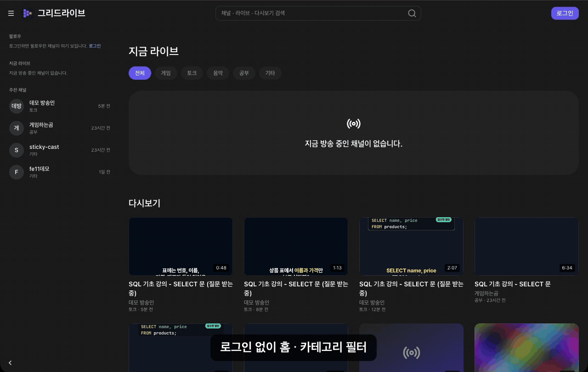

- 사용 안내: [시청](guide.md#시청)

## F2. PC 송출 → 시청
PC 스튜디오에서 제목 · 카테고리를 정하고 Chrome 탭을 공유해 송출을 시작하면, 다른 창에서 LIVE 카드로 들어가 WebRTC로 바로 봅니다. 영화관 모드 · 전체 화면도 보여 줍니다.

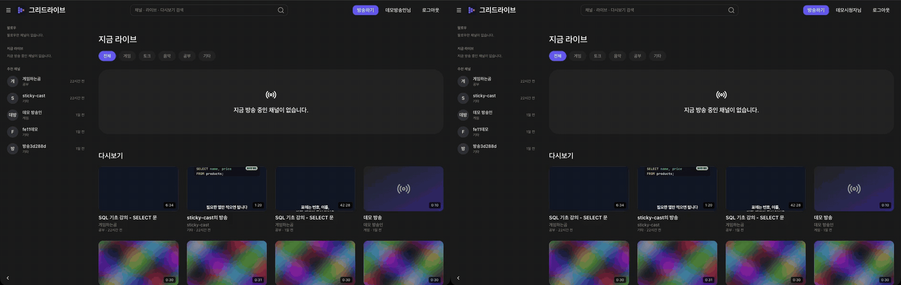

- **소리 있는 영상(mp4, 내려받기):** [`demo/f02-pc-broadcast.mp4`](demo/f02-pc-broadcast.mp4) (소리는 합성)
- 사용 안내: [PC 방송 송출](guide.md#pc-방송-송출) · [시청](guide.md#시청)
- 어필 포인트: [브라우저만으로 하는 방송 스튜디오](features.md#2-브라우저만으로-하는-방송-스튜디오)

## F3. 채팅 · 방송 중 수정
시청자가 보낸 채팅이 스튜디오에 보이고, 방송인이 답하면 "방송인" 배지로 표시됩니다. 채팅을 접으면 플레이어 위 아이콘으로 바뀌고, 송출 중 바꾼 제목 · 카테고리는 시청 화면에 바로 반영됩니다.

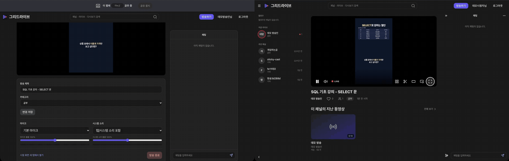

## F4. 그리드 모드
시청자 4명이 같은 방송을 봅니다. 기본 모드(WebRTC)에서 그리드 모드(HLS + 시청자 간 P2P)로 바꾸면 창마다 서버 · 피어 전송량과 절감률이 쌓이고, 마지막에 창별 통계를 확대합니다. 서버는 피어에게서 못 받은 조각만 보냅니다.

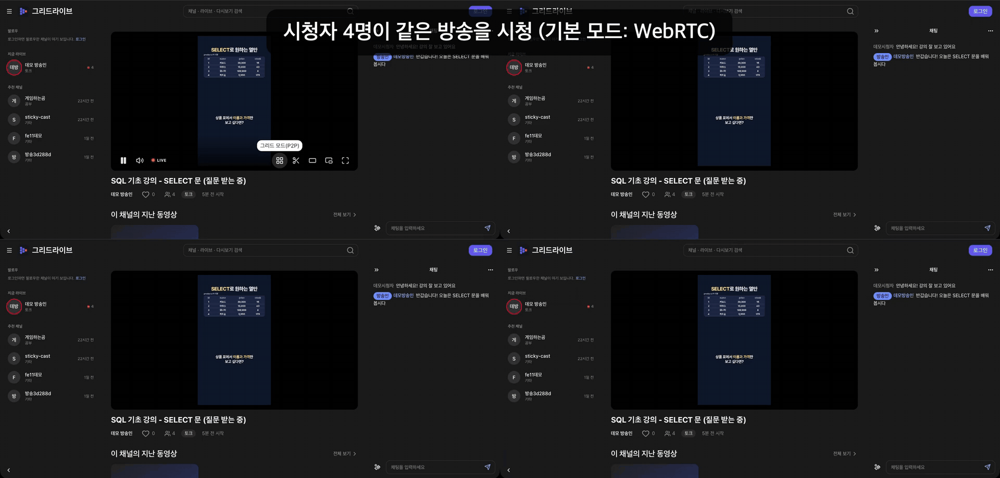

- 사용 안내: [시청](guide.md#시청)
- 어필 포인트: [시청자가 늘수록 서버가 덜 일하는 그리드 모드](features.md#1-시청자가-늘수록-서버가-덜-일하는-그리드-모드)

## F5. 라이브 클립
방송을 보다가 "클립"을 누르면 최근 2분이 초안으로 준비되고, 두 손잡이로 구간을 고르면 영상이 따라갑니다. 제목을 넣고 만들면 방송을 계속 보면서 처리되고, 클립 페이지에 "라이브에서" 출처가 표시됩니다.

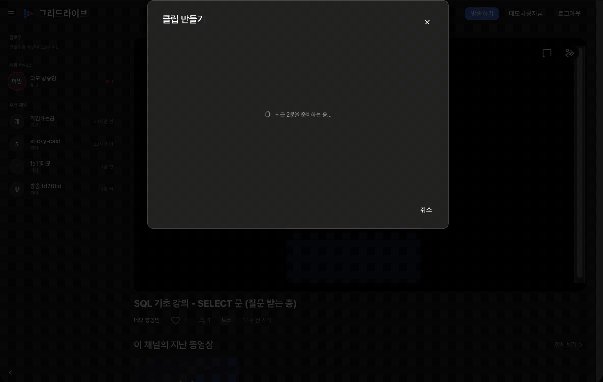

- 사용 안내: [클립](guide.md#클립)
- 어필 포인트: [라이브 클립](features.md#3-라이브-클립-방금-지나간-장면을-바로-잘라-내기)

## F6. 종료 → 다시보기
방송인이 종료하면 시청 화면이 종료 안내로 바뀌고, 녹화는 자동으로 다시보기가 됩니다. 다시보기를 재생하고 댓글을 쓰고, 다시보기에서도 구간을 골라 클립을 만들면 마이페이지 "내 클립"에 나타납니다.

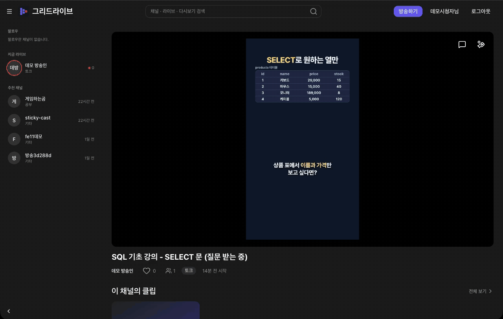

- 사용 안내: [종료](guide.md#종료) · [클립](guide.md#클립)

## F7. 후원 → 알림 위젯
시청자가 5,000원과 메시지로 후원하면 토스페이먼츠 **테스트 결제**(실제 결제 없음)가 열리고, 결제가 끝나는 즉시 채팅 강조 · 영상 위 배너 · 방송인의 OBS 알림 위젯이 같이 반응하며 위젯은 문장을 음성으로 읽습니다.

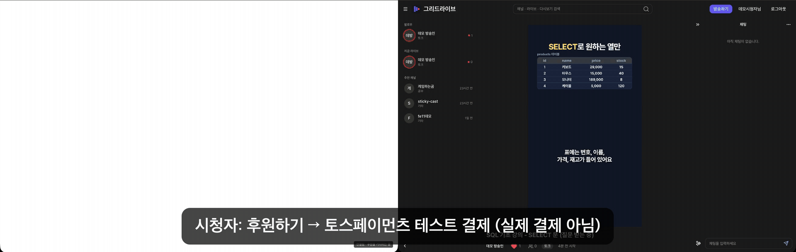

- **소리 있는 영상(mp4, 내려받기):** [`demo/f07-donation-widget.mp4`](demo/f07-donation-widget.mp4) (소리는 합성)
- 사용 안내: [시청](guide.md#시청)
- 어필 포인트: [후원 중복 승인 방지](features.md#4-틀리면-티가-안-나는-곳을-먼저-막았습니다)(같은 결제를 동시에 여러 번 승인해도 한 번만 저장)

## F8. 스트림 키 송출 · 재연결
OBS · Larix 같은 외부 프로그램은 스트림 키로 송출합니다(키는 화면에서 가렸고, 영상은 같은 방식의 RTMP 송출입니다). 송출을 끊으면 시청 화면이 "재연결 대기"로 바뀌고, 60초 안에 다시 붙으면 새로고침 없이 이어서 봅니다.

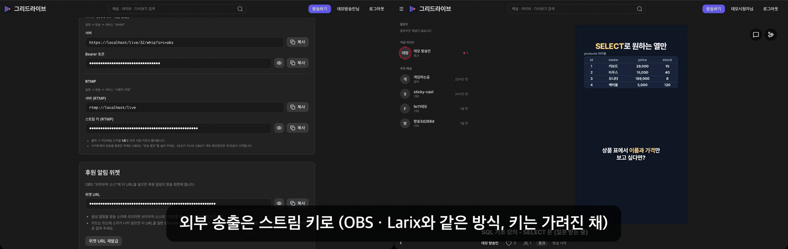

## F9. 휴대폰 송출
휴대폰으로 접속하면 모바일 스튜디오로 자동 이동합니다. 전 · 후면 전환 → 시작 → PC에서 시청하고, 채팅이 휴대폰 화면 위 반투명 줄로 올라오며 방송인 답장은 "방송인" 배지로 표시됩니다. (**PC Chrome 모바일 화면 + 가짜 카메라로 재현한 장면**입니다.)

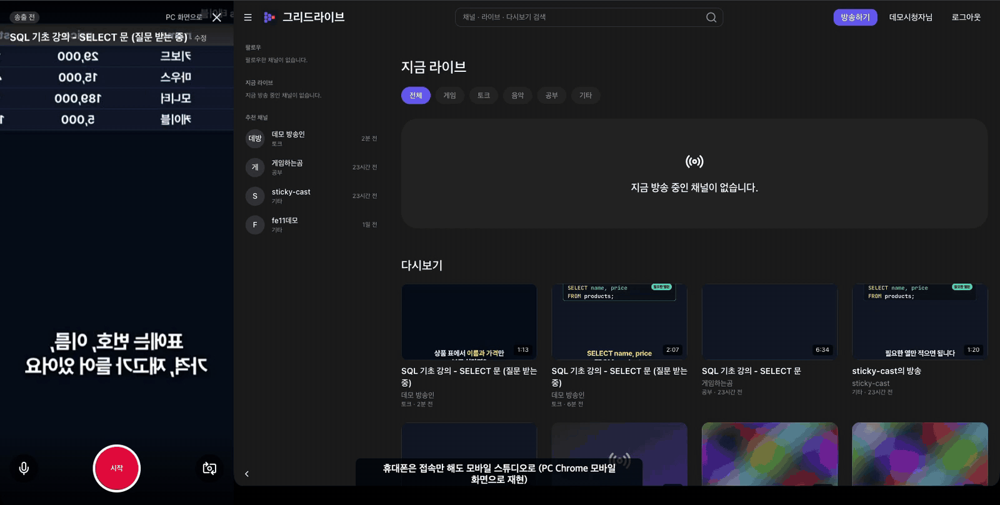

- 사용 안내: [모바일 방송 송출](guide.md#모바일-방송-송출)

## F10. 채널 · 커뮤니티 · 팔로우
채널 홈에서 다시보기 · 클립 · 커뮤니티 탭을 둘러보고, 게시글에 댓글을 쓰고, 팔로우하면 사이드바에 채널이 나타납니다.

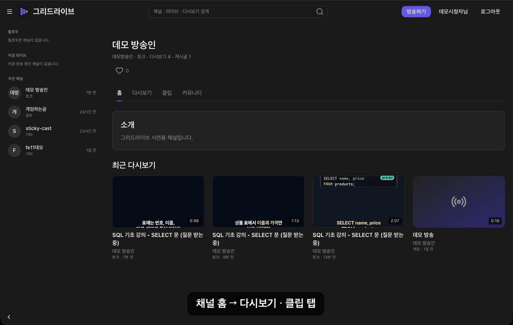

## 테스트 결과
백엔드 `./gradlew test` 결과입니다. 285개 테스트가 모두 통과했습니다(후원 중복 승인 `DonationConfirmIdempotencyTest` · 소유자 검증 · 인증 등).

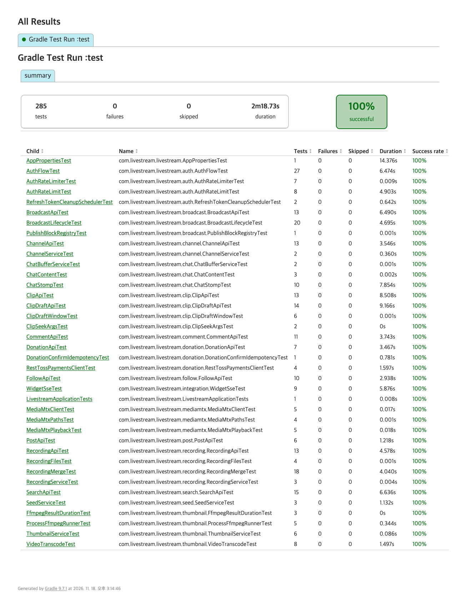
