# 시연

운영 서버([gridlive.duckdns.org](https://gridlive.duckdns.org))에서 [시연 계정](guide.md#테스트-계정)으로 찍은 화면을 기능별 GIF로 나눴습니다. 소리는 없습니다. 방송 화면은 데스크톱 Chrome의 탭 공유로 보낸 SQL 강의 영상이고, 두 창을 쓰는 장면은 왼쪽이 방송인, 오른쪽이 시청자입니다. 클립 두 장면은 로컬 환경에서 같은 영상을 송출해 찍었고, 화면의 동그라미는 마우스 위치입니다.

GIF에 없는 기능(휴대폰 송출, 후원 · 알림 위젯, 송출이 끊겼다 이어지는 재연결, OBS 송출)은 [사용 안내](guide.md#기능-확인)의 순서로 직접 확인할 수 있습니다. 클립 처리 대기(몇 초)는 빨리 감았습니다.

## 둘러보기 · 로그인

### 1. 홈 · 검색
비로그인 둘러보기, 카테고리 필터, 헤더 통합 검색(채널 · 라이브 · 다시보기).

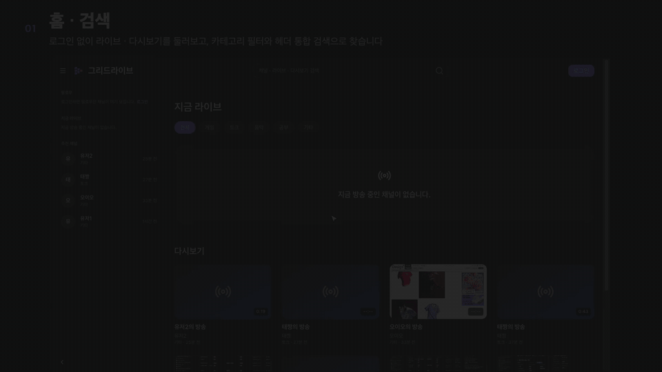

### 2. 로그인
로그인 모달.

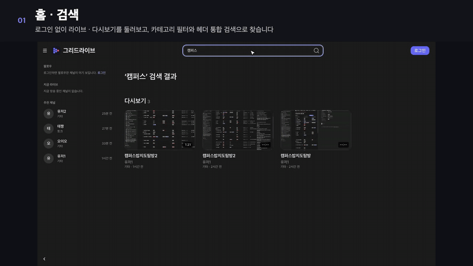

## 송출 · 시청

### 3. PC 스튜디오
제목 · 카테고리 입력, Chrome 탭 공유(화면 + 탭 소리), 마이크 · 음량 믹서.

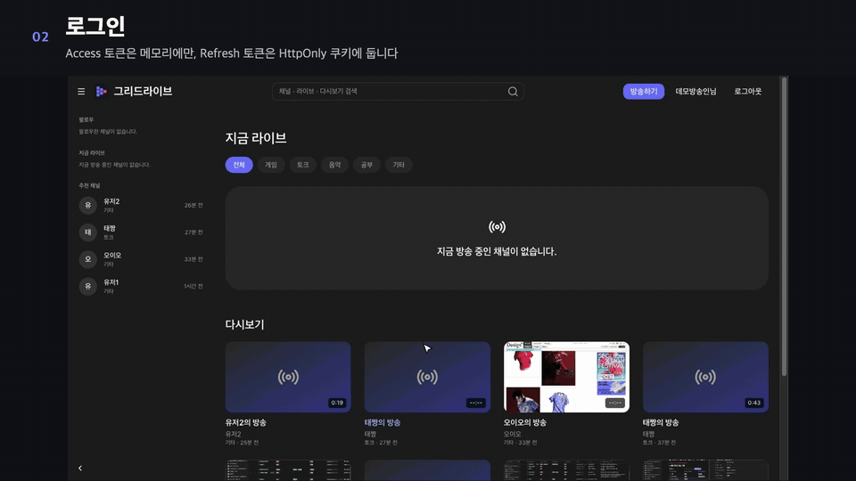

### 4. 송출 시작 → 시청
WHIP 송출 → 홈 LIVE 카드 → WebRTC(WHEP) 저지연 시청.

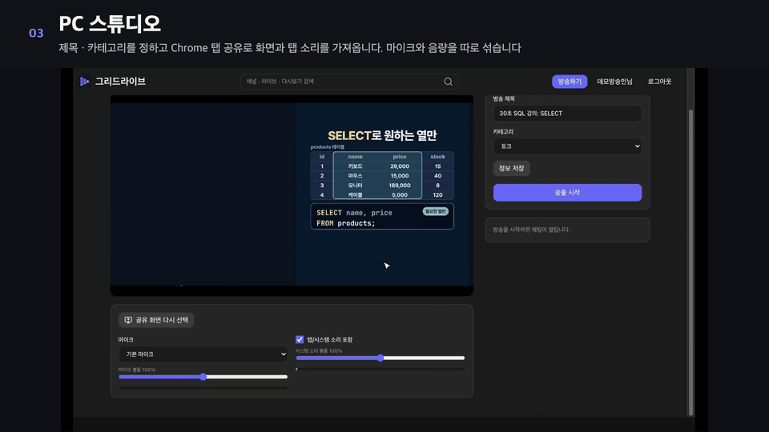

### 5. 실시간 채팅
시청자 ↔ 방송인 STOMP 채팅, 방송인 배지.

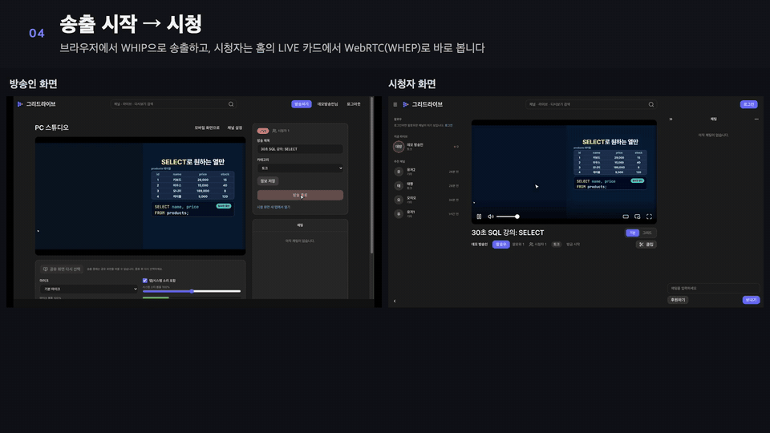

### 6. 방송 중 정보 수정
제목을 바꾸면 시청 화면에 바로 반영됩니다.

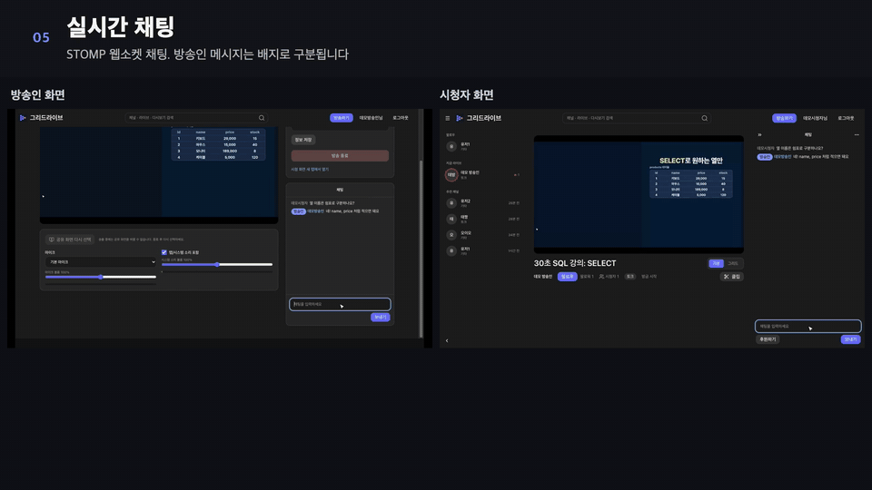

### 7. 그리드 모드
시청자가 늘어난 방송에 들어오면 HLS + 시청자 간 P2P로 재생하고, 서버 · 피어 전송량과 절감률을 표시합니다.

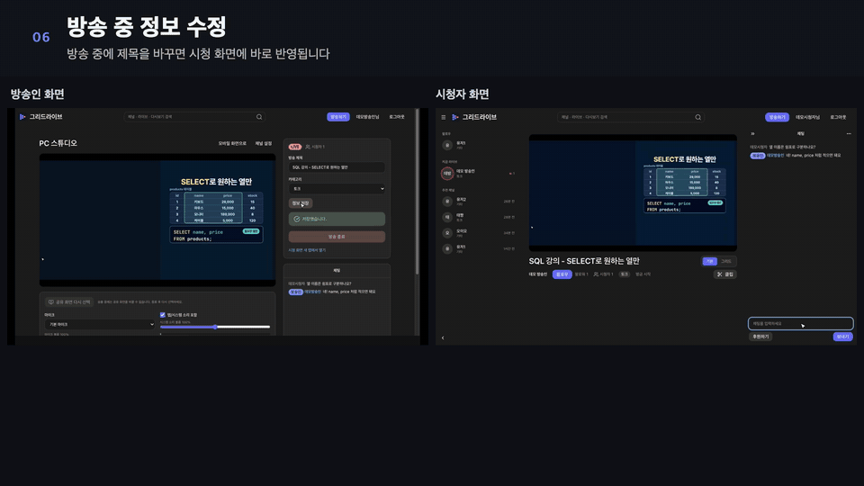

### 8. 휴대폰 시청
휴대폰 화면 배치(채팅 · 재생 모드).

### 9. 방송 종료
종료 안내 · 다시보기 버튼 · 추천 방송.

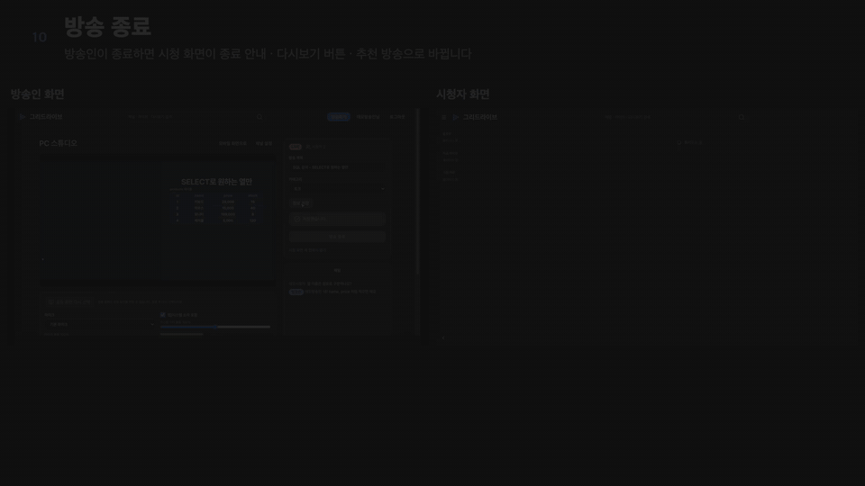

## 다시보기 · 채널

### 10. 다시보기 · 댓글
자동 녹화된 다시보기 재생, 댓글.

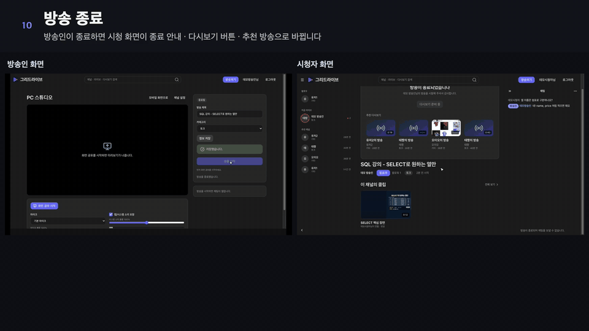

### 11. 채널 · 팔로우
채널 탭(다시보기 · 클립 · 커뮤니티), 팔로우 → 사이드바.

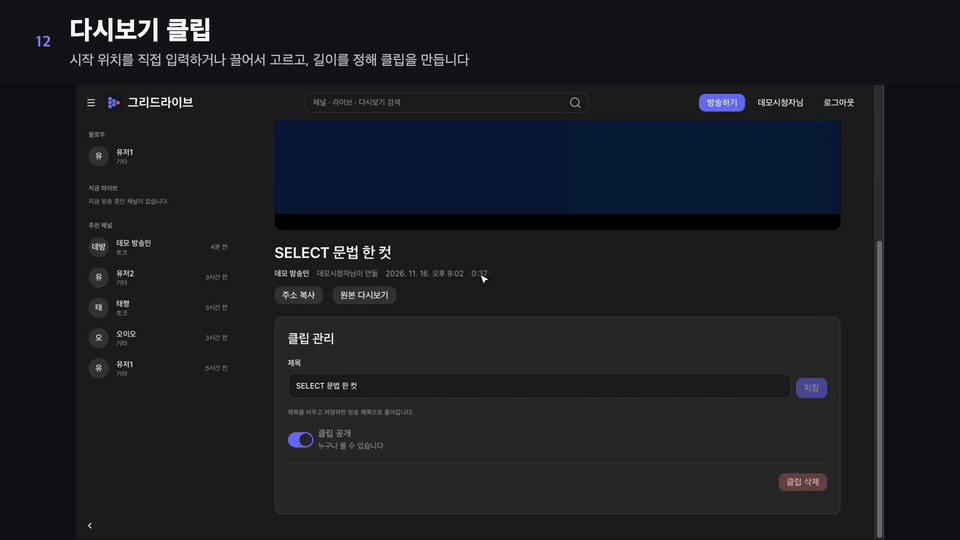

## 클립

### 12. 라이브 클립
시청 중 "클립" → 최근 2분 초안 준비 → 두 손잡이로 구간 선택(시작 손잡이를 끄는 동안은 시작 화면, 끝 손잡이는 끝 화면) → 고른 구간 자동 반복 재생 → 제목 입력 → 만들기 → 방송을 계속 보면서 "클립을 만드는 중…" → 클립 페이지("라이브에서" 표시, 제목 · 공개 관리).

### 13. 다시보기 클립
같은 화면으로 열립니다. 막대를 통째로 끌어 구간 옮기기, 끝 손잡이로 길이 조절 → 완료 알림 → 클립 페이지("원본 다시보기" 링크).

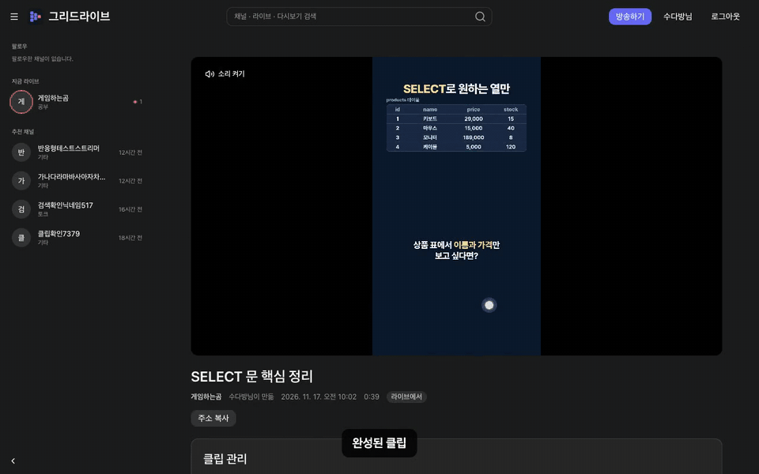

## 전체 시연 영상 (내려받기)

GitHub에서는 mp4가 바로 재생되지 않아 내려받아야 합니다.

| 파일 | 길이 | 내용 |
|---|---|---|
| [`demo/gridlive-demo.mp4`](demo/gridlive-demo.mp4) | 4분 57초 | 위 1~11 장면을 한 번에 찍은 영상(운영 서버, 장면마다 자막). 2:29 라이브 클립 · 3:42 다시보기 클립 장면은 예전 클립 화면이라 위 12 · 13 GIF가 지금 화면입니다 |
| [`demo/clip-demo.mp4`](demo/clip-demo.mp4) | 1분 33초 | 지금 클립 만들기 화면(라이브 클립 → 다시보기 클립, 로컬 환경) |
